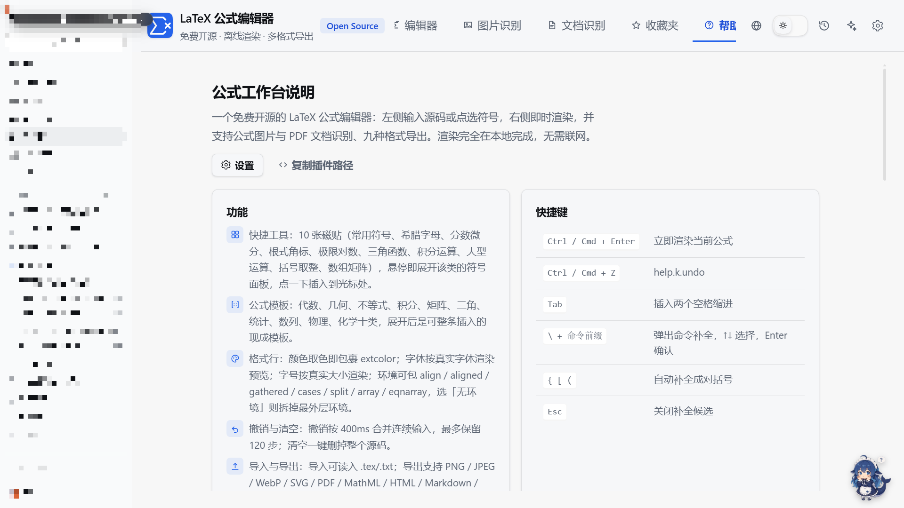

# DSH LaTeX Formula Editor

English · [简体中文](README.md)

A free, open-source and fully offline LaTeX formula editor for the **left sidebar** of the DeepSeek Harness Web UI (icon `Σ`).
Interaction follows [latexlive.com](https://www.latexlive.com/), but everything runs on your own machine: maths is
rendered by the bundled MathJax, PDFs are parsed by the bundled PDF.js — no account, no quota, no uploads
(except the recognition backend you configure yourself).

- Sidebar entry → one panel with five views: **Editor / Image OCR / Document OCR / Favourites / Help**
- Live LaTeX rendering (MathJax 3.2.2, SVG output, offline)
- Quick-tool tiles: 10 groups (common symbols, Greek, fractions & calculus, roots & scripts, limits & logs,
  trigonometry, integrals, large operators, brackets & floors, matrices); hover a tile to expand its grouped symbols
- Formula templates: algebra, geometry, inequalities, integrals, matrices, trigonometry, statistics,
  sequences, physics, chemistry
- Format row: colour picker, rendered font menu, rendered size menu, environment wrapper
  (align / aligned / gathered / cases / split / array / eqnarray / none), clear, undo, import, favourite
- Export: images (SVG / PNG / JPG), code (LaTeX / AsciiMath / Typst / SVG Code / HTML inline & display /
  MathML variants / OMML), escaping (backslash, `$…$`, `$$…$$`, `\(…\)`, `\[…\]`, JSON) and share links
- Favourites: title, timestamp, rendered preview and source per entry; rename, copy, delete, insert, search;
  configurable cap (10 by default)
- Image OCR (drag / paste / pick) and document OCR (page by page, download as Word / LaTeX / Markdown,
  the last 15 days of results can be downloaded again)
- UI: 150% default scale, light/dark theme, 简体中文 / 繁體中文 / English

## Screenshots


| Quick tools: hover expands the symbol panel | Formula templates |
| --- | --- |
|  |  |

| Document OCR (Word / LaTeX / Markdown + recent results) | Favourites |
| --- | --- |
|  |  |

| Settings | Help |
| --- | --- |
|  |  |

## Install

```bash
git clone https://github.com/jiahui-huang1/dsh-latex-formula-editor.git
pnpm dsh plugin add ./dsh-latex-formula-editor
```

Or install the published package:

```bash
pnpm dsh plugin add dsh-latex-formula-editor
```

Then enable **LaTeX Formula Editor** in the DSH sidebar (entry id `latex-editor`).

## Settings

- **Editor**: UI scale (100–200%, default 150%), source font size, word wrap, formula numbering, favourites cap
- **Recognition**: `auto` uses the harness model; otherwise fill in an OpenAI-compatible endpoint
  (URL / model / key). Rendering and export never use the network.

## Requirements

- DSH ≥ 1.0 (Cordis plugin spec: `dsh.bundle.patch` + `dsh.client`)
- No build step; MathJax 3 and PDF.js ship with the plugin

## Licence

MIT
