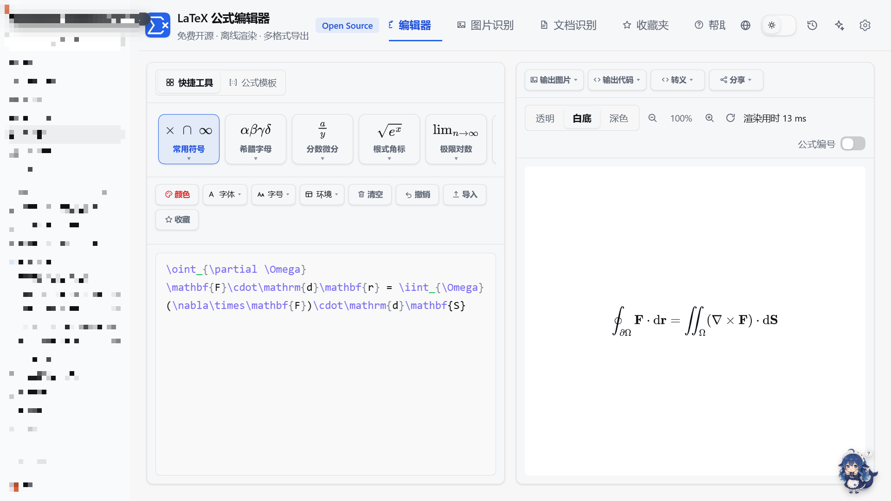
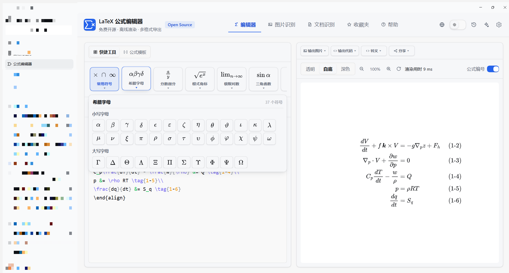
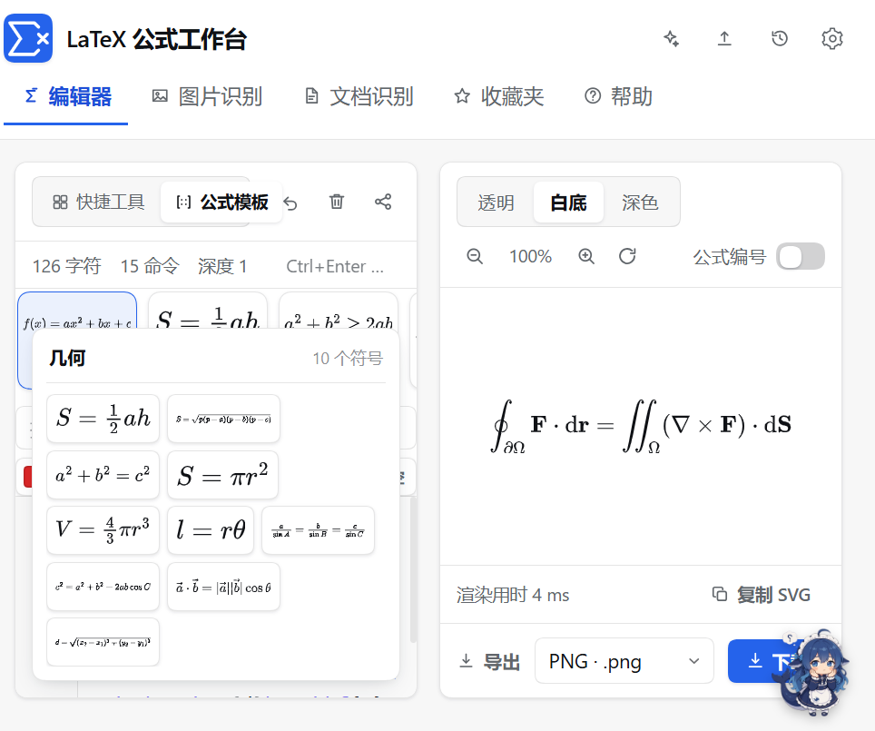
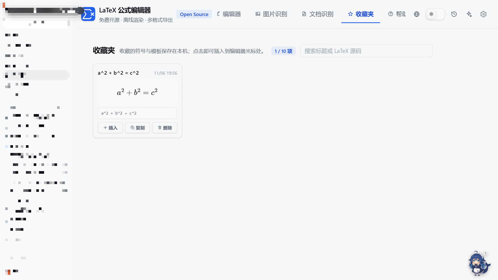
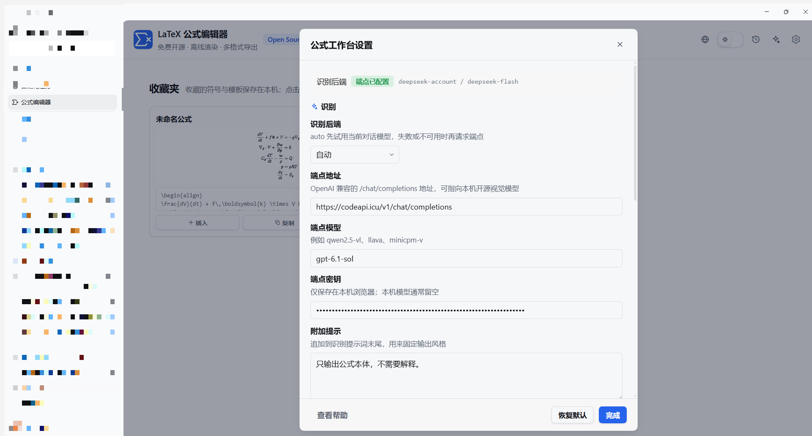

# DSH LaTeX Formula Editor

English · [简体中文](README.md)

[](https://www.npmjs.com/package/dsh-latex-formula-editor)
[](https://github.com/topics/dsh-plugin)

A free, open-source and fully offline LaTeX formula editor that lives in the **left sidebar** of the DeepSeek Harness Web UI (icon `Σ`).
Interaction follows [latexlive.com](https://www.latexlive.com/), but everything runs on your own machine: maths is rendered by the
bundled MathJax, PDFs are parsed by the bundled PDF.js — no account, no quota, no uploads (except the recognition backend you configure).

- Sidebar entry → one panel with five views: **Editor / Image OCR / Document OCR / Favourites / Help**
- Live LaTeX rendering (MathJax 3.2.2, SVG output, offline)
- UI scale **125%** by default (Settings → UI scale, 100%–200%)
- Light / dark theme switch (follows the system by default), 简体中文 / 繁體中文 / English
- Share links encode the formula in the URL hash — nothing goes through a server
- Nine export formats plus four export menus (image / code / escape / share)



## Features

### Quick tools

Ten tiles above the input: **common symbols / Greek / fractions & calculus / roots & scripts / limits & logs / trigonometry /
integrals / large operators / brackets & floors / matrices**.

- Each tile icon is a live-typeset representative formula, not an image
- Hovering a tile expands its symbol panel **4px below**, grouped exactly like the palette data (e.g. Greek → lower case 30 / upper case 11); it collapses when the pointer leaves
- Every symbol has a ☆ in its corner to save it to favourites; clicking the symbol inserts it at the caret
- The tile strip scrolls horizontally with the mouse wheel (vertical wheel is translated), so the right-most tiles are reachable



### Templates

Ten template tiles: **algebra / geometry / inequalities / integrals / matrices / trigonometry / statistics / sequences /
physics / chemistry** — hover to expand and insert a ready-made snippet (quadratic roots, law of cosines, AM-GM,
binomial theorem, variance, geometric series, Schrödinger equation, chemical equations …).



### Format row

A separate row below the tiles, divided by a rule, with eight equal 62px icon buttons:

| Button | What it does |
| --- | --- |
| Colour | Palette icon + colour picker; picking a colour wraps the selection in `\textcolor{#hex}{…}` |
| Font | Roman / bold / italic / underline / sans / blackboard / calligraphic / fraktur, each rendered in that font inside the menu |
| Size | Nine steps from tiny to huge, each rendered at that size inside the menu |
| Environment | align / aligned / gathered / cases / split / array / eqnarray, plus "none" (strips the outer environment); wraps the selection in `\begin{…}…\end{…}` |
| Clear | Empties the source |
| Undo | Undo the previous edit (keystrokes within 400 ms merge, up to 120 steps) |
| Import | Reads `.tex` / `.txt` |
| Favourite | Saves the current formula to favourites |

With a selection the text is wrapped; without one an empty shell is inserted and the caret placed inside.

### Favourites

The fifth tab; every favourite is a card:

- **Title** (the tile name when favourited from a tile, otherwise the first 24 characters of the formula, falling back to "Untitled formula"; click to rename), **timestamp**, **rendered preview**, **LaTeX source** (click to copy)
- **Insert / Copy / Delete** buttons
- A search box filters by **title or source**
- The cap defaults to **10** (Settings → Favourites limit, 1–50); beyond it the oldest entry is removed and a warning toast says so



### Output

The export bar sits at the top of the preview column, with four menus:

| Menu | Options |
| --- | --- |
| Image | SVG / PNG / JPG (3× scale) |
| Code | LaTeX, AsciiMath, Typst, SVG Code, HTML inline, HTML display, MathML, MathML (mml:), MathML (m:), MathML (attr:), OMML |
| Escape | Escaped backslash, `$…$`, `$$…$$`, `\(…\)`, `\[…\]`, JSON string |
| Share | Copy the share link (`#tex=` encoded — opening it restores the formula) |

AsciiMath and Typst are produced by a real TeX parser and OMML by converting the MathML DOM into Word's formula structure — not by copying the LaTeX source.

- Structured formulas: fractions, superscripts/subscripts, roots (including `\sqrt[n]{}`), integral/sum limits and matrices are written as real OMML, so they stay editable in Word; `pmatrix` / `bmatrix` / `vmatrix` / `matrix` become a native Word matrix with the matching delimiters
- Matrices, `cases` and `aligned` map to Typst constructs (`mat(...)`, `cases(...)`, `&` alignment), and font commands such as `\mathbb` / `\mathcal` / `\mathfrak` become `bb()` / `cal()` / `frak()`; the Typst output is compiled against typst 0.15.1 as part of verification
- AsciiMath has limited expressive power: environments such as `cases` / `aligned` still emit the closest possible output, together with a "not fully converted" notice so you can decide whether to adjust it

The canvas background follows the theme: white in the light theme, black in the dark theme (transparent / white / dark can still be picked manually).

### Recognition

- **Image OCR**: drop, paste or pick an image; the configured model returns LaTeX and inserts it
- **Document OCR**: renders each PDF page and recognises it page by page; when done you can **download Word (.docx) / LaTeX / Markdown** — the Word file contains real Office Math (Cambria Math) equations, with fractions, roots, scripts and matrices preserved and editable in Word. Switching tabs does not interrupt a run, and records are kept forever by default (a retention period can be set in Settings, and the list can be cleared by hand). Each record can also be **viewed** (read-only page-by-page dialog) or **sent straight to the editor**, without downloading or re-running recognition


### Interface

- **125%** scale by default, adjustable 100%–200%; narrow panels switch to a compact layout (tabs wrap, actions become icons, panels scroll internally)
- Light / dark slider (sun / moon icons), system default
- Language menu: 简体中文 / 繁體中文 / English (traditional Chinese is derived from the simplified dictionary on the fly)



## Install

The plugin is normally mounted from a **local directory** (`link:` dependency), and it is also available on npm:

```bash
# local directory
git clone https://github.com/jiahui-huang1/dsh-latex-formula-editor.git
pnpm dsh plugin add ./dsh-latex-formula-editor

# or from npm
pnpm dsh plugin add dsh-latex-formula-editor
```

Then enable **LaTeX Formula Editor** in the DSH sidebar (entry id `latex-editor`). Restart DSH after changing the plugin.

## Layout

```
index.js                Host half: static asset routes, recognition endpoint, settings persistence, latex_formula tool
client.js               Client entry: registers the sidebar entry (sidebar.panellist) and the main panel (main)
lib/
 ├─ 00-core.js           namespace, i18n, settings store, UI primitives, icons
 ├─ 10-latex.js          symbol palette / templates / parser / source utilities
 ├─ 20-render.js         MathJax rendering, nine export formats, PDF writer
 ├─ 30-visual.js         legacy symbol / template panels and structure tree
 ├─ 35-tiles.js          quick-tool and template tiles, favourites, export menus
 ├─ 40-recognition.js    recognition backends (harness model / OpenAI-compatible endpoint)
 ├─ 45-convert.js        TeX → AsciiMath / Typst, MathML → OMML
 ├─ 50-app.js            main UI: editor, preview, export, history, share
 ├─ 56-recognition-panels.js  image and document OCR panels
 ├─ 60-settings-help.js  settings and help page
 └─ 90-skin.js           corporate-clean skin and theme tokens
vendor/                 MathJax 3.2.2 and PDF.js (shipped with the plugin)
```

## Settings

- **Editor**: UI scale (125% default), source font size, word wrap, formula numbering, favourites limit
- **Recognition**: `auto` prefers the harness model; otherwise fill in an OpenAI-compatible endpoint (URL / model / key)
- Rendering and export are fully offline; only OCR sends the image to your backend
- Settings live in `<DSH_HOME>/latex-editor/settings.json`; the endpoint key is written there too (plain text), so leave it empty on shared machines

## Requirements

- DSH ≥ 1.0 (Cordis plugin spec: `dsh.bundle.patch` + `dsh.client`)
- No build step on the browser side; MathJax and PDF.js ship with the plugin

## Licence

MIT
