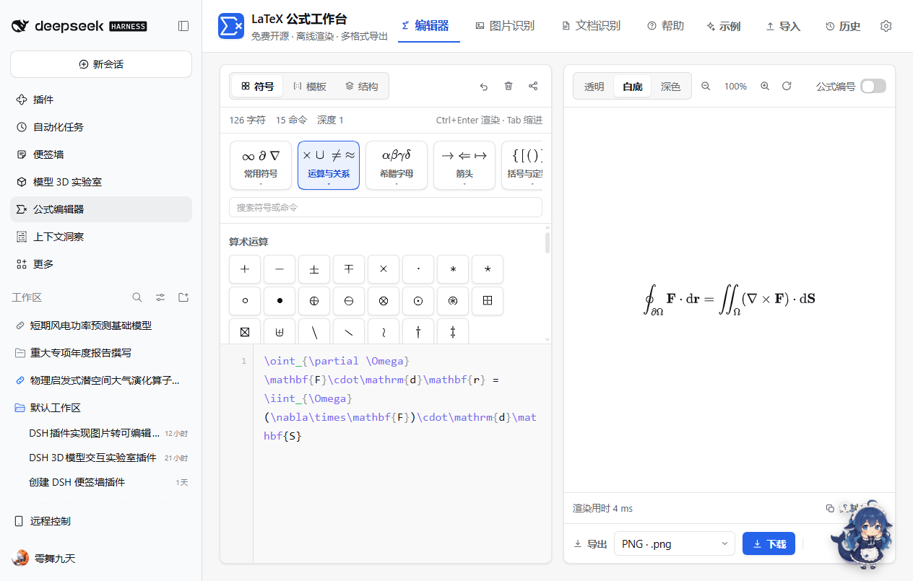
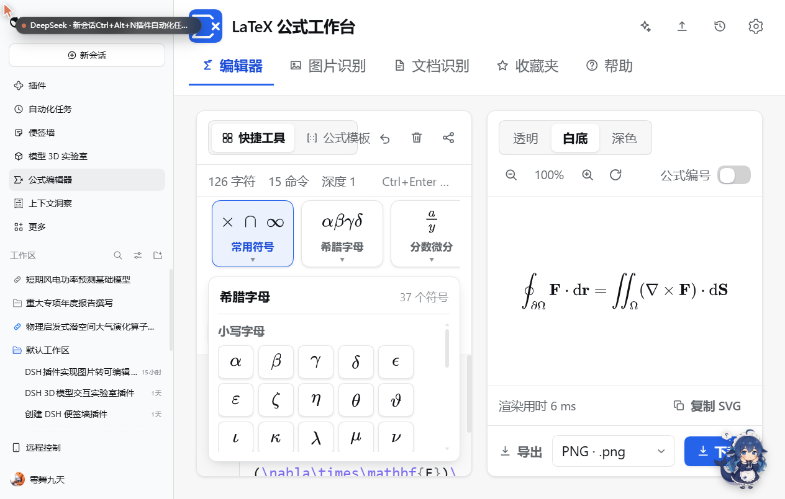
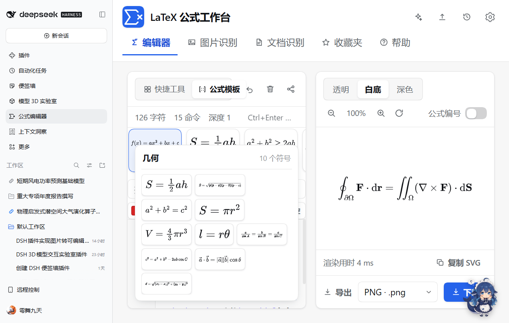
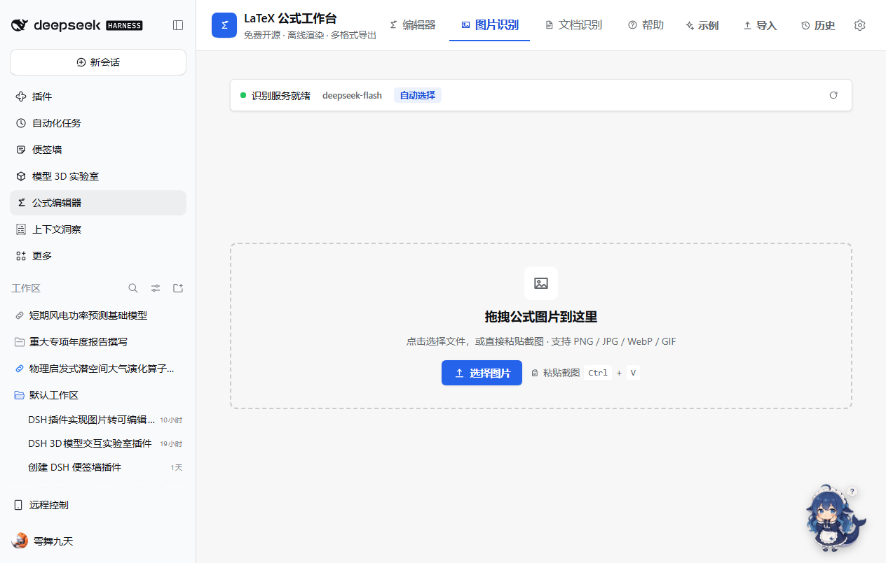
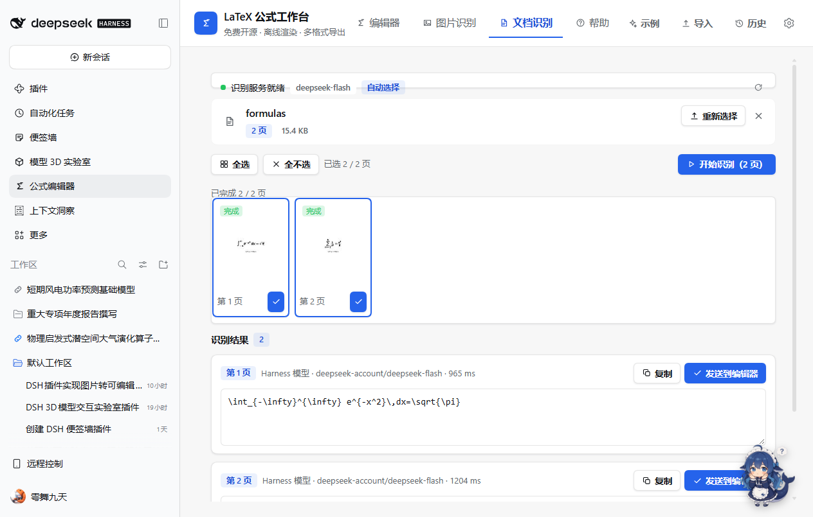
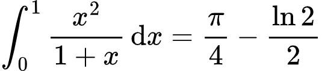
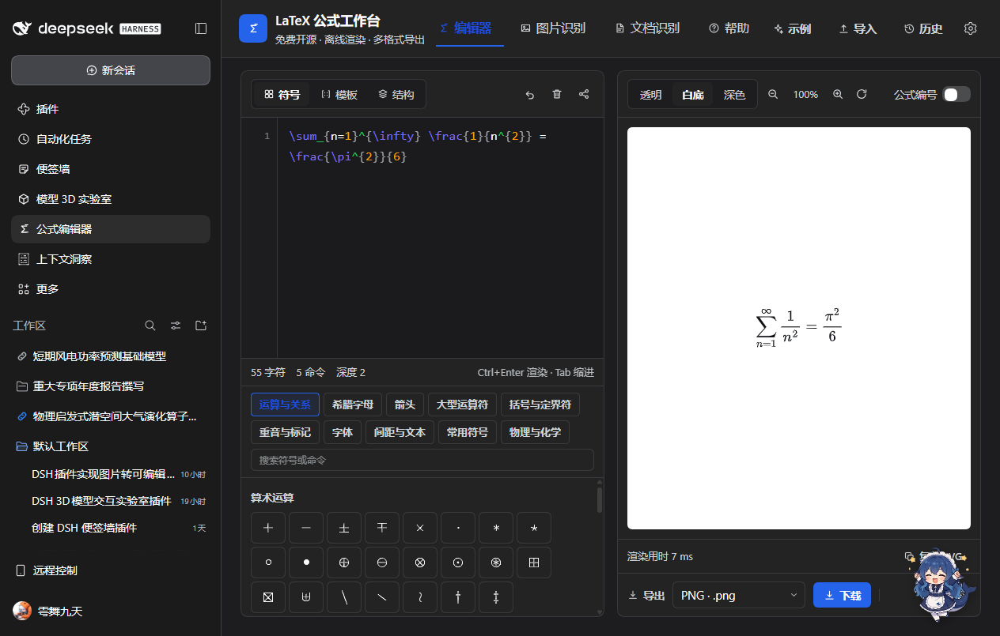

# DSH LaTeX 公式工作台 / Formula Workbench

一个免费开源、可离线使用的 LaTeX 公式编辑器插件，挂在 DeepSeek Harness Web UI 的**左侧栏**（图标 `Σ`）。
功能与交互参考 [latexlive.com](https://www.latexlive.com/)，但**全部在自己的机器上运行**：数学渲染用随包分发的
MathJax，PDF 解析用随包分发的 PDF.js，没有账号、没有额度、没有上传（除了你自己选择的识别后端）。

- 侧栏入口 → 主面板，四个视图：**编辑器 / 图片识别 / 文档识别 / 帮助**
- LaTeX 实时渲染（MathJax 3.2.2，SVG 输出，离线）
- 分类符号表（10 类 · 37 组 · 438 个符号）+ 结构模板（9 组 · 48 个）
- 快捷工具磁贴：每个分类一张悬浮卡片（数学预览图标 + 名称 + ▾），点击切换分类
- 公式结构树：点选定位源码，支持包裹、环境加行、删除、复制
- 公式图片识别（拖拽 / 粘贴 / 选择文件）
- PDF 文档逐页识别，可批量导出 `.tex` / `.md`
- 九种导出格式：SVG / PNG / JPG / WebP / PDF / MathML / LaTeX / HTML / Markdown
- 分享链接把公式编码进 URL hash，不经过任何服务器
- 界面缩放默认 **150%**（设置 → 界面缩放可在 100%–200% 之间切换）
- `latex_formula` 工具：让 agent 也能识别公式图片、保存公式文件

---

## 截图

| 工作台（默认 150% 缩放） | 同一界面的 100% 缩放 |
| --- | --- |
|  |  |

| 快捷工具磁贴的展开面板 | 公式模板磁贴的展开面板 |
| --- | --- |
|  |  |

| 图片识别 | 文档识别 |
| --- | --- |
|  |  |

| 内置说明文档 |
| --- |
|  |

| 导出示例（PNG，3×） | 深色主题 |
| --- | --- |
|  |  |

---

## 1. 安装

本仓库本身就是一个 DSH bundle（`package.json` 里声明了 `dsh.bundle.patch` 与 `dsh.client`）。
在 DSH 里安装本地插件目录即可：

```bash
# 在 DSH 会话里让 agent 执行，或使用插件管理界面
plugin_manager  action=install_bundle  target=<本目录的绝对路径>
```

安装后左侧栏出现 `Σ 公式编辑器` 入口。若要改 Host 半的默认配置，编辑该 bundle 的 `cordis.patch.yml`
中的 `config`（`backend`、`endpointUrl`、`endpointModel`、`endpointKey`、`maxImageBytes`、`timeoutMs`），
或者直接用面板内的「设置」（面板写入的设置会持久化到 `<DSH_HOME>/latex-editor/settings.json` 并覆盖默认值）。

## 2. 目录结构

```
dsh-latex-editor-plugin/
├─ package.json              bundle 清单（dsh.bundle.patch + dsh.client）
├─ cordis.patch.yml          Loader 补丁：插入 latex-editor 行
├─ index.js                  Host 半：静态资源路由、/recognize、/settings、latex_formula 工具
├─ client.js                 Client 入口：加载 lib/*、注册字典、侧栏入口与主面板
├─ lib/
│  ├─ 00-core.js             window.__LX 命名空间：i18n、设置、API、主题化 UI 原语
│  ├─ 10-latex.js            符号表 / 模板 / 解析器 / 源码工具（纯逻辑）
│  ├─ 20-render.js           MathJax 渲染与九种导出（含手写 PDF 生成器）
│  ├─ 30-visual.js           符号面板、模板面板、结构树
│  ├─ 40-recognition.js      识别调用、PDF.js 封装、图片归一化
│  ├─ 50-app.js              工作台外壳：编辑器、预览、导出条、历史、分享
│  ├─ 56-recognition-panels.js  图片识别 / 文档识别的界面
│  ├─ 60-settings-help.js    设置弹窗与帮助文档
│  └─ 90-skin.js             企业简洁风样式层（设计 token、组件皮肤、动效与焦点环）
├─ locale/{zh,en}.json       Plugin Manager 里显示的标题与描述
├─ icon.svg                  插件图标
├─ vendor/mathjax/           MathJax 3.2.2 tex-svg-full（MPL-2.0 / Apache-2.0）
└─ vendor/pdfjs/             PDF.js 3.11.174 UMD（Apache-2.0）
```

## 3. 编辑器

| 能力 | 说明 |
| --- | --- |
| 源码高亮 | 命令、括号、环境、数字、注释分别着色，覆盖层与输入框逐像素对齐 |
| 括号匹配 | 光标挨着 `{ } [ ] ( )` 时高亮配对括号 |
| 自动补全 | 输入 `\` + 至少两个字母后弹出候选，`↑ ↓` 选择，`Enter` / `Tab` 确认，`Esc` 关闭 |
| 自动成对 | 输入 `{ [ (` 自动补全右括号；输入右括号会自动跳过 |
| 撤销 | 工具栏撤销按钮（带 120 步历史，400ms 合并） |
| 快捷工具 | 与 LaTeX Live 对齐的 10 张磁贴：常用符号 / 希腊字母 / 分数微分 / 根式角标 / 极限对数 / 三角函数 / 积分运算 / 大型运算 / 括号取整 / 数组矩阵。磁贴图标是 MathJax 排版的代表公式，悬停上浮 2px；**悬停即在该磁贴正下方 4px 处紧贴展开符号面板并按组分类**（关系符号 / 运算符号 / 集合与逻辑 …，希腊字母分小写/大写），高度上限为磁贴行到面板底部的剩余空间，移开收拢；磁贴行支持滚轮横向滚动。 |
| 公式模板 | 10 张模板磁贴：代数 / 几何 / 不等式 / 积分 / 矩阵 / 三角 / 统计 / 数列 / 物理 / 化学，每张展开一组可直接插入的模板（求根公式、余弦定理、均值不等式、二项式定理、薛定谔方程、化学方程式 …）。 |
| 收藏夹 | 顶部第五个页签。每条收藏带**标题（默认「未命名公式」，点击可改）**（点击可改名）、**收藏时间**、**MathJax 预览**、**LaTeX 源码**（点击即复制），并有 **插入 / 复制 / 删除** 三个按钮；顶部搜索框可按标题或源码检索；数量上限默认 **10**，在 设置 → 收藏夹上限 里改（1–50，超出时丢弃最旧的一条）。悬停面板里的 ☆ 也是收藏入口。 |
| 格式工具（磁贴行下方以分隔线隔开） | 磁贴行下单独一行，**七个等宽 62px 的图标按钮**（自动换行，标签不折行）：**颜色**（取色器，选色即包裹 \textcolor）、**字体**（下拉每项直接用该字体渲染 ABC）、**字号**（下拉每项直接渲染不同大小的 abc）、**环境**（无环境 / eqnarray / align / aligned / gathered / cases / split / array，选中即包 \begin{…}…\end{…}，无环境则拆掉最外层环境）、**清空**、**撤销**、**导入**（.tex/.txt）、**收藏**（把当前公式存进收藏夹）。有选中文字就包裹，没有则插入空壳并把光标放进去。 |
| 结构树 | 解析当前公式为节点树：点击跳转并选中对应源码；选中节点后可包成分数、根号、上下标、括号、绝对值、文本、加粗、上划线，或对 `matrix/cases/aligned` 环境加一行、删除、复制片段 |
| 预览 | MathJax SVG；透明 / 白底 / 深色三种背景；40%–300% 缩放；公式编号开关（`\tag{n}`） |
| 错误提示 | TeX 报错以错误条显示，不中断渲染 |

快捷键：`Ctrl/Cmd+Enter` 立即渲染、`Tab` 缩进两格、`Esc` 关闭补全。

## 4. 识别后端

识别有两种后端，任选其一即可；都不可用时界面会**明确报错**，不会伪造结果。

1. **当前对话模型**（默认 `auto` 的首选）
   如果当前会话使用的模型声明支持图片输入（`inputModalities` 含 `image`），图片会直接交给它识别，
   无需任何配置。面板「设置 → 识别后端 → 自动」即可。
2. **OpenAI 兼容端点**
   在「设置」里填写 `/chat/completions` 地址、模型名、可选密钥。可以指向本机或局域网里的开源视觉模型：

   ```
   地址  http://127.0.0.1:11434/v1/chat/completions     # Ollama
   模型  qwen2.5-vl
   密钥  本机模型留空
   ```

   Host 会把图片编码为 `data:` URL 放进 `image_url`，`temperature=0`，只取回答正文里的 LaTeX
   （自动剥离 ```` ```latex ```` 围栏、`$$…$$`、`\[…\]` 与多余说明）。

后端选择、端点信息、附加提示都会由面板通过 `PUT /plugins/latex-editor/settings` 写回 Host，
因此刷新页面或换会话后依然生效。

## 5. 文档识别

- 仅支持 PDF；单文档 ≤ 100 页、≤ 50 MB（与 latexlive 的口径一致）
- 用 PDF.js 在浏览器内解析并渲染页面缩略图，不把 PDF 上传到任何地方
- 逐页顺序识别，实时进度、可取消、失败页可单独重试
- 默认每批最多 30 页（设置可改），识别结果可复制、发送到编辑器，或整篇导出 `.tex` / `.md`

## 6. 导出

| 格式 | 扩展名 | 说明 |
| --- | --- | --- |
| SVG | `.svg` | 矢量，MathJax 字形路径内联，无外部依赖 |
| PNG | `.png` | 透明背景位图（3× 渲染） |
| JPG | `.jpg` | 白底位图，体积更小 |
| WebP | `.webp` | 现代位图格式 |
| PDF | `.pdf` | 手写单页 PDF，位图以 FlateDecode（或 JPEG DCTDecode）嵌入，无第三方依赖 |
| MathML | `.mml` | MathML 标记，便于与其他编辑器交换 |
| LaTeX | `.tex` | 原始源码 |
| HTML | `.html` | 内嵌 SVG 的独立网页 |
| Markdown | `.md` | `$$` 包裹的公式块 |

预览区还可以直接「复制 SVG」「复制 LaTeX」「复制 MathML」。

## 7. 界面风格（企业简洁风 / Corporate Clean）

视觉遵循企业简洁风规范，落点在 `lib/90-skin.js` 这一层里统一收口，功能模块只负责结构：

| 项目 | 规则 | 实现 |
| --- | --- | --- |
| 主色 | blue-600 / blue-700，仅用于主要操作与焦点 | `--lx-accent:#2563eb`、`--lx-accent-hover:#1d4ed8` |
| 焦点 | `ring-2 + ring-offset-2`（WCAG 2.1 AA 分离式焦点环） | `box-shadow: 0 0 0 2px 表面色, 0 0 0 4px #3b82f6` |
| 圆角 | 只用 `rounded-lg` / `rounded-xl`，禁止直角 | 按钮/输入 8px，卡片/面板 12px |
| 表面 | 页面浅灰、卡片白底、边框灰 | 由宿主 token 混合出 `--lx-page / --lx-card / --lx-border`，浅深色自动适配 |
| 阴影 | 静止 `shadow-sm`，悬停 `shadow`，卡片悬停 `shadow-md` | `--lx-shadow-sm / --lx-shadow / --lx-shadow-md` |
| 动效 | 全部 ≤200ms，`ease-out`；按钮按压 `scale(.98)`；悬停上浮 1–2px | `.lx-btn` / `.lx-exp-chip` / `.lx-pal-item` / `.lx-tpl-item` |
| 渐变 | 禁止用于控件；标志为扁平蓝色块 | 头部 `Σ` 标记与插件图标均为纯色 |
| 减弱动效 | 尊重 `prefers-reduced-motion` | 关闭过渡、悬停位移与动画 |

### 字阶（2026-11 调大一档）

| 层级 | 字号 | 字重 |
| --- | --- | --- |
| 面板标题 / 弹窗标题 | 17px | 600 |
| 页签 | 15.5px（激活 700） | 500 |
| 正文、输入框、按钮 | 14.5px | 正文 400 / 按钮 600 |
| 辅助文字、提示 | 13.5px | 400 |
| 徽标、状态、快捷键 | 12.5–13px | 500–600 |
| 公式预览 | 基准 ×1.18（缩放控件 100% 即此基准） | — |
| 源码编辑器 | 默认 16px，可调 12–22，行高固定 26px | — |
| 界面缩放 | 默认 **150%**（相对 DSH 界面），可选 100/125/150/175/200% | — |

按钮统一 `font-weight:600`、高度 36/32px（大/小），导出与结构操作按钮同样加粗；行内图标随字号放大（15/17px）。
源码字号设置此前**实际无效**——浏览器 UA 样式表把 `<textarea>` 固定为 13.33px，继承不生效；现已显式
`font-size: inherit` 并对齐高亮层与行号栏。旧的本地设置（15px）会通过设置版本迁移一次性抬到 16px。

标题用 `font-semibold` + `tracking-tight`，正文行宽限制 68ch；图标容器悬停转为品牌色底 + 白色图标 + 轻微放大。
深色主题沿用同一套 token，不写死颜色。

**界面缩放**：整个工作台包在一个 `zoom` 外壳里（`.lx-shell`，`zoom: var(--lx-ui-scale)`），默认 150%，所以字号、间距、磁贴、图标整体等比放大。缩放后布局宽度变成了 `面板宽 ÷ 缩放`，媒体查询看不到这一变化，因此外壳用 `ResizeObserver` 量出实际宽度并标记 `data-compact`（0/1/2）：≥860 双栏、620–860 紧凑（页签换行、图标化动作、抽屉按比例缩短）、<620 堆叠 + 面板内滚动。

**符号区结构**：抽屉只保留「磁贴行 + 格式行」（约 230px 高，四周内边距 10–12px，磁贴顶部留出上浮/阴影空间）；搜索栏已移除，不再常驻符号网格；符号通过悬停面板或搜索结果面板以浮层展开，因此源码区拿到更多高度（150% 下约 262px，可见 6 行）。

**预览底色随主题**：切浅色主题时输出画布自动用白底、切深色主题时自动用黑底（透明/白底/深色仍可手动覆盖，主题切换会重新同步）。

**预览列布局**：导出条（导出格式 + 下载 + 复制 SVG）移到预览列顶部，画布在其下方，编辑列与预览列上下边严格对齐。

**环境与编号**：`normalize()` 只拆 `equation` / `displaymath` / `math` 这类纯展示外壳，`align`、`gather`、`eqnarray`、`multline`、`alignat` 等对齐环境原样保留（否则 `&` 会报 Misplaced &）；MathJax 打开 `tags: 'ams'` 并把 SVG 设为 `overflow: visible`，`\tag{1-2}` 这类编号才会显示在公式右侧。

**符号渲染**：命令预览统一放大到 1.4 倍（细箭头在 1.12 倍下看着像被截断）；对不产生墨迹的命令（`\quad`、`\,`、`\displaystyle`、`\limits`、`	ag`…）改为显示命令文本标签，而不是空白格子；渲染报错同样回退到文本。

**语言与主题**：右上角地球按钮弹出菜单，直接选 简体中文 / 繁體中文 / English（繁体由简体词表实时转换，当前项打钩）；旁边的滑动开关左边太阳=浅色、右边月亮=深色，默认跟随系统。主题挂在 `.lx-root[data-theme]` 上覆盖 `--dsw-alias-*`，因此**整个工作台**（页头、页签、磁贴、编辑区、预览、导出条）一起切换。页头五个按钮统一 30px 高、间距 8px。

**侧栏与标题图标**：完全复刻提供的 LaTeX Live 标志 SVG（1024 视框、原路径、无缩放变形），颜色做阴阳互换——原图 `#2c2c2c` 深色路径改为白色（`currentColor`/`#ffffff`）压在品牌蓝 `#2563eb` 上；`icon.svg` 同源。

它的布局对照 latexlive：顶部是模式页签（编辑器 / 图片识别 / 文档识别 / 帮助）+ 右侧工具动作，
中间是「输入卡片 · 输出卡片」两栏，输入卡片**上方**是符号/模板/结构抽屉（自上而下：工具行 → 统计行 → 符号面板 → 源码），输出卡片底部是
「格式选择 + 下载 + 复制」的单行导出条。

## 8. 分享链接

点击编辑器工具栏的分享图标会把当前公式编码进 URL hash：

```
http://127.0.0.1:7506/#latex-editor=<base64url(公式)>
```

链接只包含公式本身，打开链接即恢复编辑状态；不会写入任何后端。

## 9. Agent 工具 `latex_formula`

```jsonc
// 识别一张本地公式图片
{ "action": "recognize", "image_path": "D:/papers/fig1.png", "hint": "第 3 节的损失函数" }

// 把公式写进当前会话工作目录
{ "action": "save", "latex": "\\int_0^1 x^2 dx", "format": "md" }
```

## 10. 隐私

- 渲染、解析、导出全部在浏览器与本地 Host 进程内完成，不联网。
- 只有「识别」会把**一张图片**（或 PDF 的一页）发给你选择的后端：要么是 DSH 正在用的模型服务，
  要么是你在设置里填的端点。除此之外没有任何网络请求。
- 设置与当前公式保存在浏览器 `localStorage`，面板设置另存一份在 `<DSH_HOME>/latex-editor/settings.json`。

## 11. 二次开发

浏览器半是**无构建**的传统脚本：`client.js` 依次注入 `/plugins/latex-editor/lib/*.js`，
每个模块都是 `;(function(){ const LX = window.__LX; ... })()` 的形式，只往 `window.__LX` 上添加自己
命名空间下的键（`LX.latex` / `LX.render` / `LX.visual` / `LX.recog` / `LX.recogUI` / `LX.pages` / `LX.app`）。
新增模块时：在 `client.js` 的 `MODULES` 里加文件名、在 `package.json` 的 `files` 保持 `lib/*.js`
通配即可，无需重新安装。Host 侧改动（`index.js`）需要重新加载插件。

模块之间的契约见 [`docs/CONTRACT.md`](docs/CONTRACT.md)。

## 12. 许可

- 本插件：MIT
- MathJax 3.2.2：Apache-2.0 / MPL-2.0（见 `vendor/mathjax/LICENSE`）
- PDF.js 3.11.174：Apache-2.0（见 `vendor/pdfjs/LICENSE`）

## 13. 已知边界

- 文档识别只接受 PDF；不处理扫描件的版面分析，只逐页整页识别。
- 识别质量取决于所选后端；本插件不做后处理纠错。
- 源码自动补全基于内置命令表，不索引 `\newcommand` 自定义宏。
- PDF 导出为单页位图版式（不是矢量 PDF），需要矢量请用 SVG。
