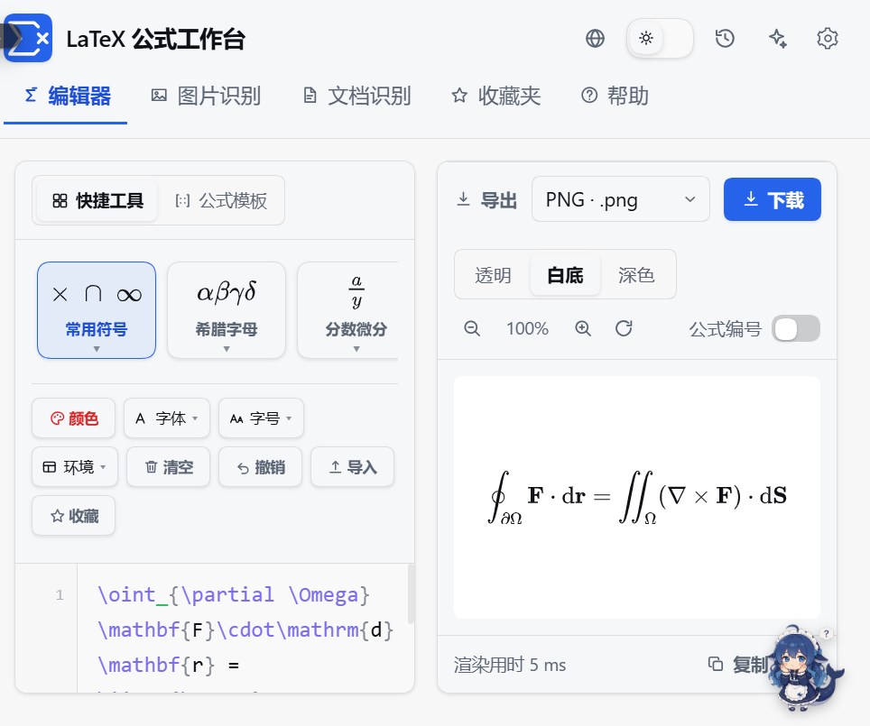
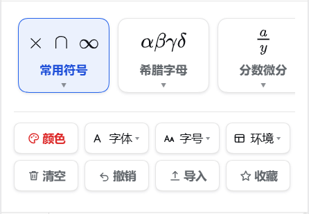

# dsh-latex-formula-editor · LaTeX 公式编辑器

免费开源的 LaTeX 公式编辑器，以 DSH 左侧栏插件形式运行，界面参考 LaTeXLive：MathJax 实时渲染、10 张快捷工具磁贴、10 类公式模板、颜色/字体/字号/环境控件、收藏夹、图片与 PDF 识别、九种导出格式。渲染与导出全部在本机离线完成，识别只在你配置了后端时才联网。

## 功能

| 区域 | 说明 |
| --- | --- |
| 快捷工具 | 常用符号 / 希腊字母 / 分数微分 / 根式角标 / 极限对数 / 三角函数 / 积分运算 / 大型运算 / 括号取整 / 数组矩阵，悬停磁贴展开分组符号面板，点击插入光标处 |
| 公式模板 | 代数 / 几何 / 不等式 / 积分 / 矩阵 / 三角 / 统计 / 数列 / 物理 / 化学，展开即可整条插入 |
| 格式行 | 颜色取色器、按真实字体渲染的下拉、按真实字号渲染的下拉、环境包裹（align / aligned / gathered / cases / split / array / eqnarray / 无环境）、清空、撤销、导入、收藏 |
| 收藏夹 | 每条带标题（默认「未命名公式」）、时间、渲染结果与 LaTeX 源码；可改名、复制、删除、插入；支持按标题或源码搜索；上限默认 10，设置里可改 |
| 输出区域 | 输出图片（SVG/PNG/JPG）、输出代码（LaTeX/AsciiMath/Typst/SVG/HTML/MathML/OMML）、转义（`$…$`、`$$…$$`、`\(…\)`、`\[…\]`、JSON）、分享链接 |
| 识别 | 图片拖拽/粘贴识别、PDF 逐页识别 |
| 界面 | 默认 150% 缩放、浅色/深色主题、简体中文 / 繁體中文 / English |

## 安装

把本目录作为插件加入 DSH，然后在左侧栏启用「公式编辑器」。

## 许可

MIT
